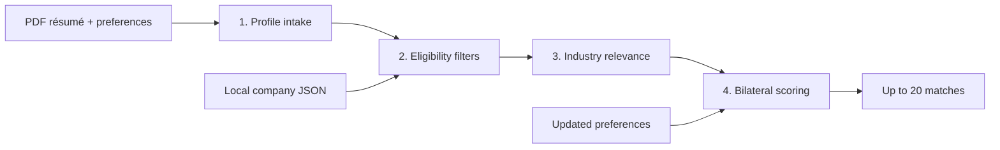

# MatchPoint

**Find your next opportunity, with a shortlist you can understand.**

MatchPoint is an OJT (on-the-job training) matching prototype for fourth-year FEU students. It turns a résumé and work preferences into a ranked shortlist of industry partners, with a breakdown of how each match was scored.

The project was originally scaffolded as **OJT Scout**, which is still the name used in the package metadata and several source files. The current interface is branded MatchPoint.

[Explore the interactive project guide](https://acespades10.github.io/MatchPoint/) · [Architecture](OJT_SCOUT_ARCHITECTURE.md) · [Development log](DEV_LOG.md)

## What it does

- **Builds a student profile:** extracts text from a PDF résumé and uses a configured AI provider to structure skills, experience, and course information. Skills without supporting evidence default to beginner.
- **Checks eligibility first:** applies year-level, MOA status, available-slot, accepted-course, allowance, and work-setup filters.
- **Checks industry relevance:** uses deterministic course, résumé-field, and industry rules to retain direct and adjacent matches. Unknown industry classifications are surfaced for verification.
- **Explains bilateral fit:** combines student-side preferences with company-side signals, showing individual score components.
- **Re-ranks without another AI call:** changes to setup, location, allowance, and active-partner preferences re-score the existing relevant pool.
- **Offers a no-key demo:** a sample profile skips résumé parsing and runs the matching pipeline against the local company dataset.

The GitHub Pages site is a separate, interactive explanation with fictional data. It does not upload résumés, ask for API keys, contact AI services, or run the Express backend.

## Run locally

Use a supported Node.js LTS release (Node 22 or newer recommended; the package declares a minimum of Node 18) and npm.

```sh
git clone https://github.com/acespades10/MatchPoint.git
cd MatchPoint
npm ci
npm start
```

Open [http://localhost:3000](http://localhost:3000) and choose **Explore with a demo résumé**. No `.env` or AI key is required for this mode. Access to the repository is required if it is private.

For development with automatic server restarts:

```sh
npm run dev
```

### Use a real résumé

1. Supply a text-based PDF, up to 10 MB. Image-only PDFs are not supported by the current text extractor.
2. Set your work preferences before running the match.
3. Configure an AI connection in the current application UI, or copy `.env.example` to `.env` and set `OPENAI_API_KEY` for the server-side provider. Leave placeholder keys out of `.env`.
4. Choose **Find My Match**, then inspect the profile and score breakdowns.

On PowerShell, copy the example with `Copy-Item .env.example .env`; on macOS/Linux, use `cp .env.example .env`.

The current connection layer supports OpenAI-compatible Chat Completions and Codex gateway Responses endpoints. The configured model must be available from the selected provider; inspect `src/core/AIConnection.js` and `src/core/BasePrompt.js` when changing that integration.

Résumé text is sent to the configured AI provider. The current UI's **Save** action stores the connection URL and API key in browser local storage; **Clear** removes the saved connection. Use a trusted local environment. The public project guide has no credential or upload fields.

### Configuration

| Variable | Purpose | Default |
| --- | --- | --- |
| `PORT` | Express listening port | `3000` |
| `COMPANIES_DATA_PATH` | Local company JSON file | `./data/companies.json` |
| `OPENAI_API_KEY` | Server-side provider credential for real résumé parsing | None |
| `OPENAI_ORG_ID` | Optional provider organization | None |

Other values in `.env.example` include settings reserved for planned integrations. They are not all consumed by the current four-phase pipeline.

## How matching works



Only real résumé intake calls an AI provider. Eligibility checks, industry relevance, scoring, and re-ranking use local rules and arithmetic.

### Scoring

```text
student fit = skills × 0.30 + allowance × 0.25
            + location × 0.25 + work setup × 0.20

company-side fit = learnability × 0.60 + active-intern signal × 0.40

bilateral score = round(student fit × 0.60 + company-side fit × 0.40)
```

Company-side fit is a heuristic based on available data, not an employer assessment or hiring probability. Missing information can produce neutral scores.

| Tier | Score |
| --- | --- |
| Ideal | 75–100 |
| Good | 60–74 |
| Reach | 45–59 |
| Low | Below 45 |

The current scorer orders direct industries before adjacent industries, then active-intern partners before other partners within each industry tier, then bilateral score. It returns up to 20 companies. Low-scoring entries are normally omitted, but can remain when fewer than five non-low results are available.

Initial preferences participate in eligibility screening. Later preference changes only re-score the pool that survived that run; they do not bring back companies eliminated earlier. Start a new run to reconsider the full dataset.

## API

| Method | Route | Purpose |
| --- | --- | --- |
| `GET` | `/api/health` | Dataset readiness and company counts |
| `POST` | `/api/pipeline/start?mock=true` | Run the sample profile without AI |
| `POST` | `/api/pipeline/start` | Upload `resume` as multipart PDF, with optional JSON-string `preferences` and `connection` fields |
| `GET` | `/api/pipeline/results/:sessionId` | Retrieve a stored result |
| `POST` | `/api/pipeline/rerank/:sessionId` | Re-score with JSON `preferences` and optional `activeOnly` |
| `GET` | `/api/pipeline/cities` | Available cities from the dataset |

Sessions live in process memory, with a cap of 200 entries. They disappear on restart or eviction. This is a prototype, without production authentication or persistent student accounts.

## Repository layout

```text
api/pipeline/       Express matching and result routes
constants/         Course mappings, skill adjacency, prompts, sample profile
data/              Local company records
docs/              Standalone GitHub Pages project guide
public/            Actual matching application's HTML, CSS, and JavaScript
scripts/           Dataset extraction and enrichment utilities
src/core/          Shared prompt, filter, scorer, and connection abstractions
src/data/          Company index and data helpers
src/filters/       Six eligibility filters
src/pipeline/      Four-phase pipeline, session storage, no-match handling
src/scorers/       Student-side and company-side scoring
tests/             Node.js tests
server.js          Express entry point
```

### Data and checks

The app loads `data/companies.json` at startup. To rebuild it from a local IALAP workbook or CSV:

```sh
npm run extract -- ./ialap.xlsx
```

Extraction overwrites the company JSON. Review the output before replacing a curated dataset. Source records and imported defaults are not guarantees of current openings, MOA validity, allowance, or hiring activity; confirm these with the institution or company.

```sh
npm test
```

Tests use Node's built-in test runner and cover filters, relevance, scoring, preferences, and connection handling. No live provider request is needed for the unit tests.

## GitHub Pages

The project guide lives entirely in `docs/`, with relative asset URLs so it works at `/MatchPoint/`. It is plain HTML, CSS, and JavaScript with no build dependencies or external assets.

To preview, open `docs/index.html` in a browser, or serve `docs/` with any static HTTP server.

For deployment, select **Settings → Pages → Deploy from a branch → main → /docs** in GitHub. GitHub publishes only the guide; the actual matching app still needs a Node.js server. GitHub Pages availability for a private repository depends on the account plan. Do not change repository visibility just to enable Pages without considering the contents of the repository.

## Current scope and next steps

**Implemented:** PDF intake, sample-profile mode, eligibility filtering, industry relevance, bilateral ranking, score explanations, and preference re-ranking.

**Planned:** broader company enrichment, application-document generation, application checklists, and tracking. These are not implemented end-to-end. The architecture and roadmap documents contain design goals and historical phase numbering; the source code is the reference for current behavior.

The walkthrough's students, companies, and scores are illustrative. It demonstrates the interaction and explains the approach; it is not a live vacancy directory or evidence of placement outcomes.
